<div align="center">

<a href="https://slack-reverse.vercel.app"></a>

<p>
  <a href="https://slack-reverse.vercel.app"></a>
  
  
  
  
</p>

**A Slack-style team chat with every premium feature unlocked, a bot teammate and a brand-new look.**

### 🌐 Try it live: **[slack-reverse.vercel.app](https://slack-reverse.vercel.app)**

<a href="https://slack-reverse.vercel.app"></a>

<sub>Sign in with Google or GitHub. The server sleeps when idle, so the first visit can take up to a minute to connect.</sub>

[Tour](#-take-the-tour) · [Inside the app](#-inside-the-app) · [Themes](#-make-it-yours) · [Features](#-everything-thats-unlocked) · [Architecture](#-how-it-works) · [Run it](#-run-it-locally) · [Deploy](#-deploy)

</div>

---

## 🎬 Take the tour

> Everything below is from the live site. Open **[slack-reverse.vercel.app](https://slack-reverse.vercel.app)** to try it yourself.

<table>
<tr>
<td width="50%" valign="top">

### The home page

A motion-graphic landing page with a robot that follows your cursor, a live demo chat and a scroll-driven tour of the product.

<a href="https://slack-reverse.vercel.app">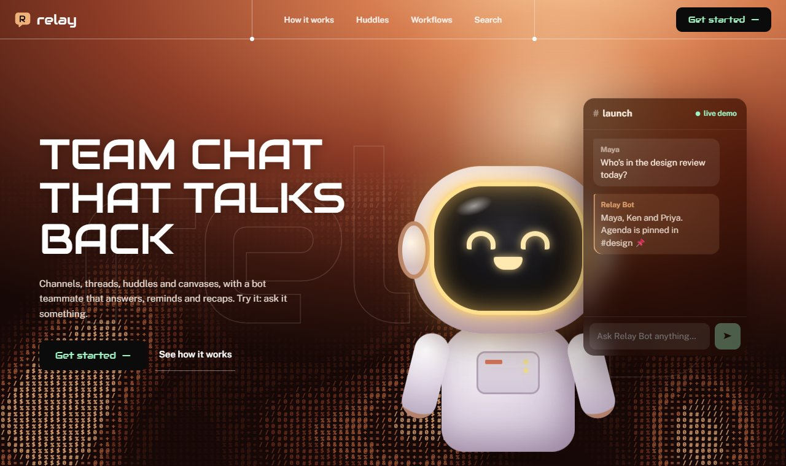</a>

</td>
<td width="50%" valign="top">

### The sign-in page

A 3D stage where the scene and the card tilt toward your cursor. Sign in with Google or GitHub, with an optional invite code.

<a href="https://slack-reverse.vercel.app">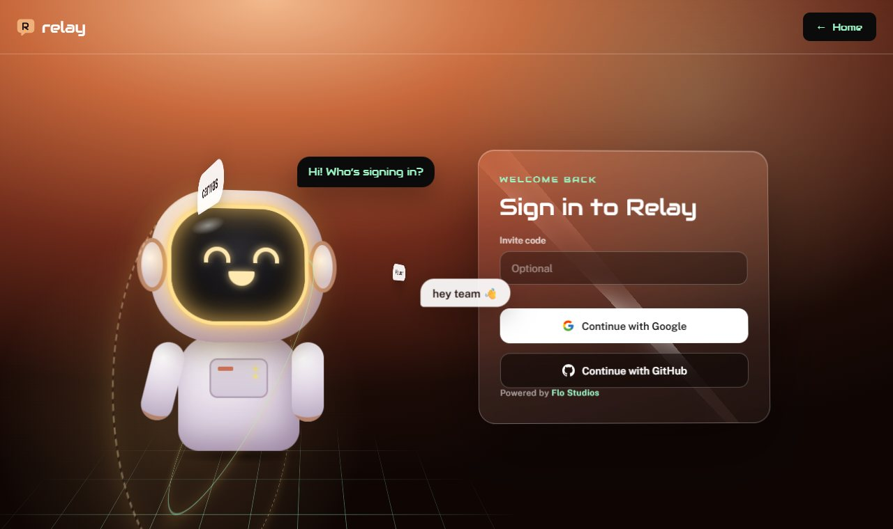</a>

</td>
</tr>
</table>

<div align="center">

| The intro | Home → sign-in |
| :---: | :---: |
|  | 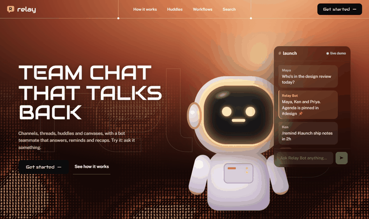 |
| The logo draws itself, then the splash lifts away. Click or press any key to skip it. | Panels sweep across the screen as the page changes underneath them. |

</div>

<details>
<summary><b>▶ Scroll the whole landing page</b> (3.8 MB GIF)</summary>
<br>
<div align="center">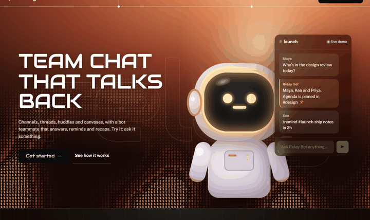</div>
</details>

<details>
<summary><b>▶ See each scene of the scroll tour</b></summary>
<br>

| Threads | Huddles |
| :---: | :---: |
| 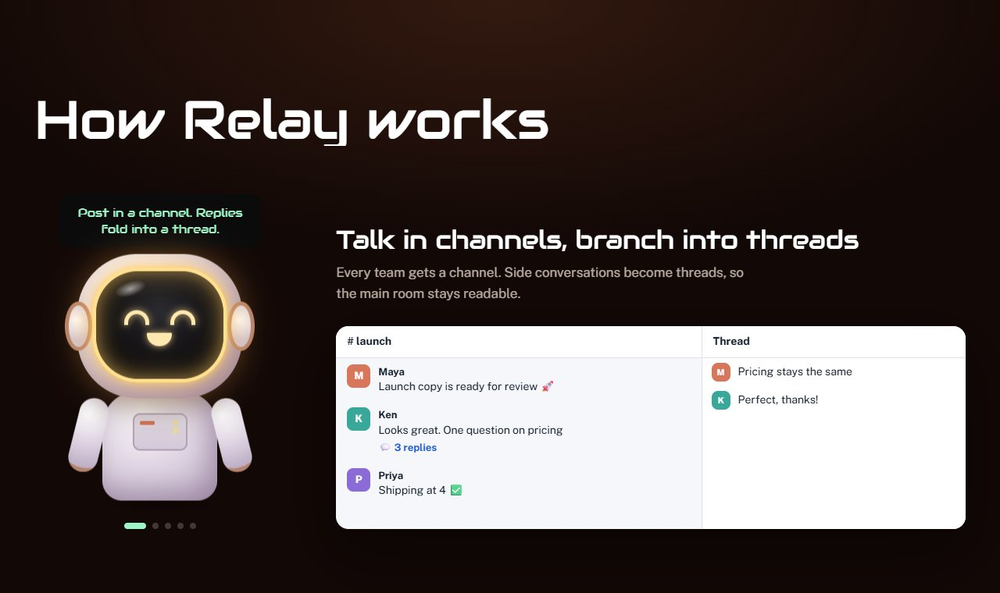 | 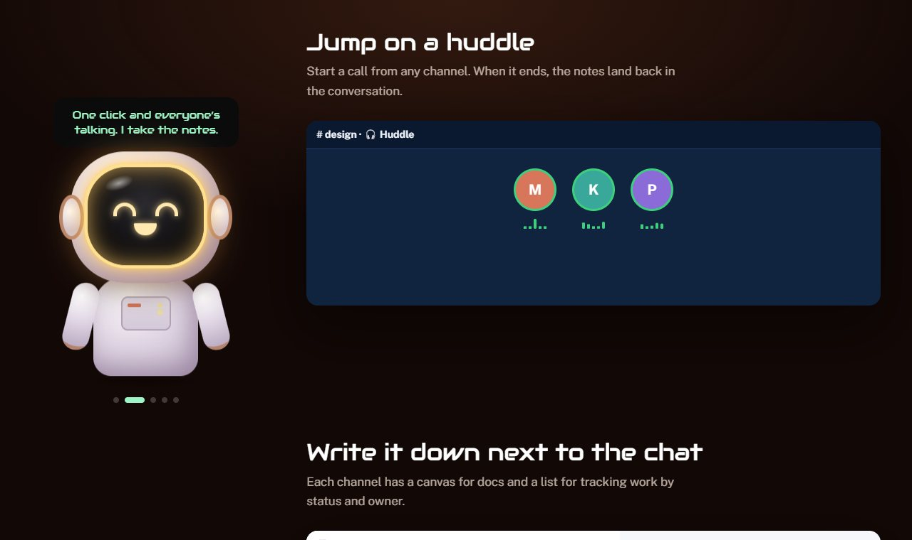 |
| **Workflows** | **Search** |
| 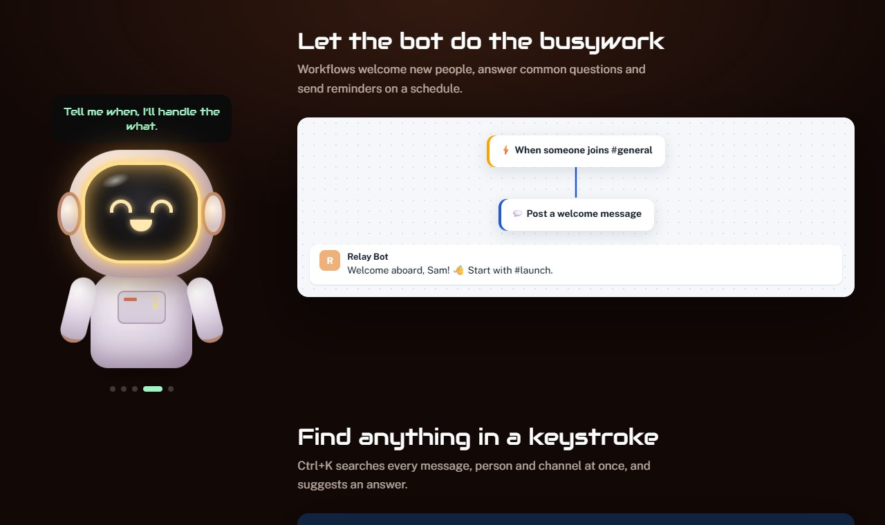 | 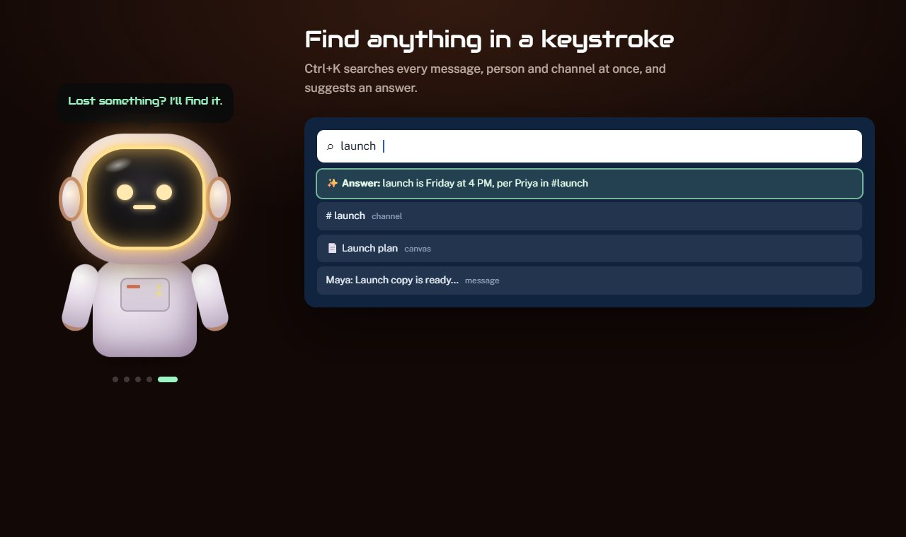 |

</details>

<details>
<summary><b>▶ The robot is watching</b></summary>
<br>
<div align="center">
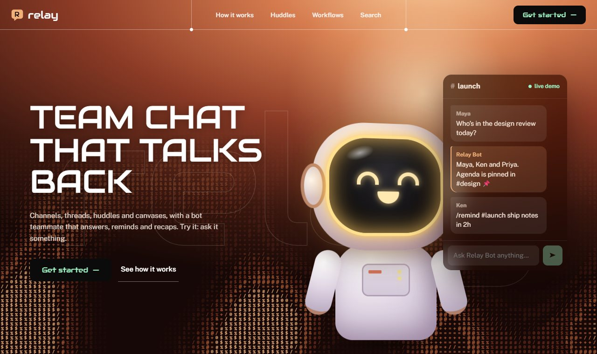
<p><sub>Move your cursor around the hero and the robot's head follows it, while the big ghost wordmark drifts the other way.</sub></p>
</div>
</details>

---

## 💬 Inside the app

<div align="center">
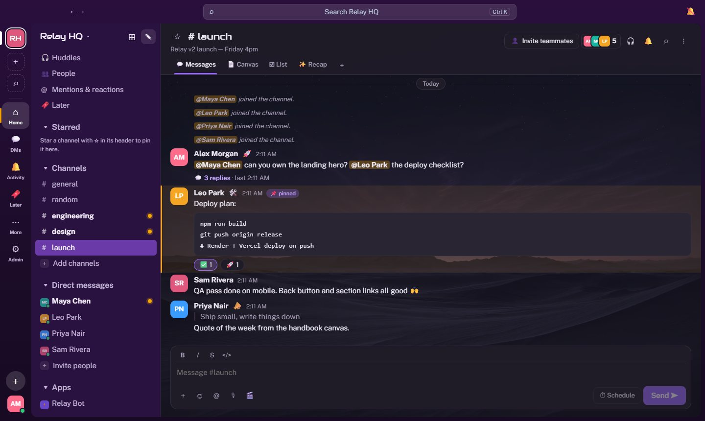
<sub>#launch: mentions, a pinned code block, reactions, a quote, and a thread with 3 replies.</sub>
</div>
<br>

<table>
<tr>
<td width="50%" valign="top">
<b>🧵 Threads</b><br>
<sub>Replies fold into a side panel with its own composer and a one-click summary.</sub>
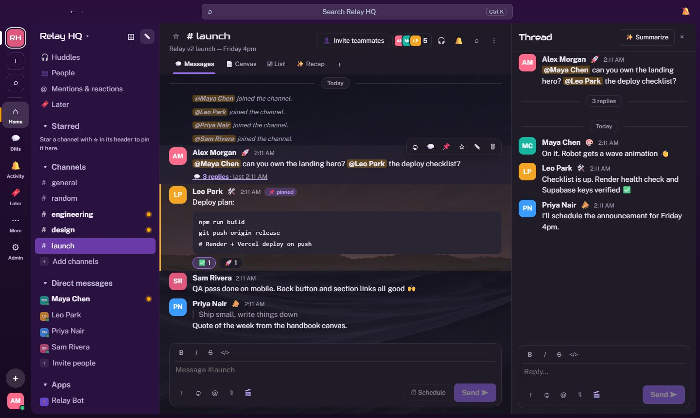
</td>
<td width="50%" valign="top">
<b>📄 Canvases</b><br>
<sub>A shared doc in every channel, with headings, lists and live @mentions.</sub>
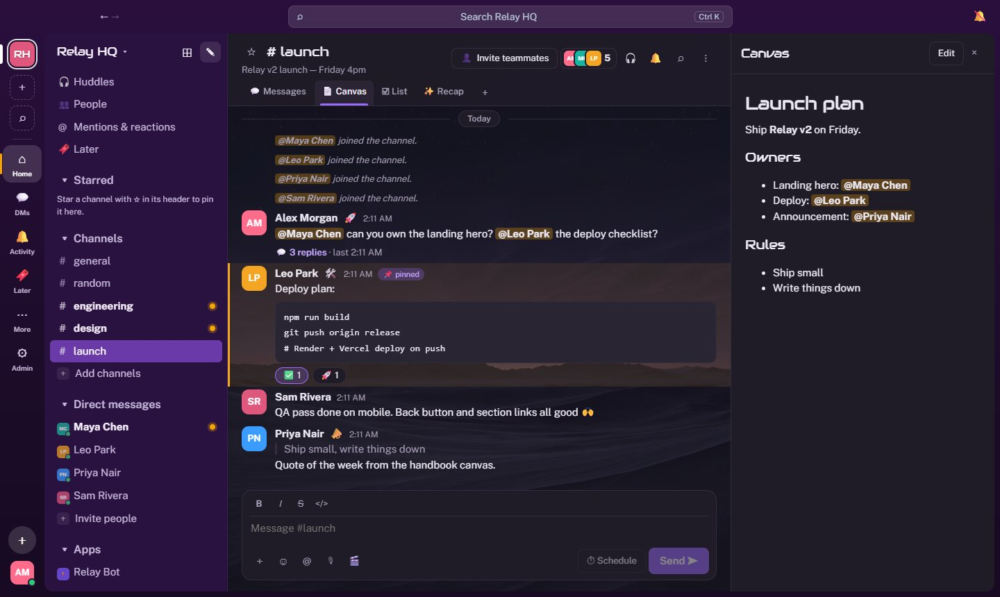
</td>
</tr>
<tr>
<td width="50%" valign="top">
<b>☑ Lists</b><br>
<sub>A task board grouped by status, with assignees and due dates.</sub>
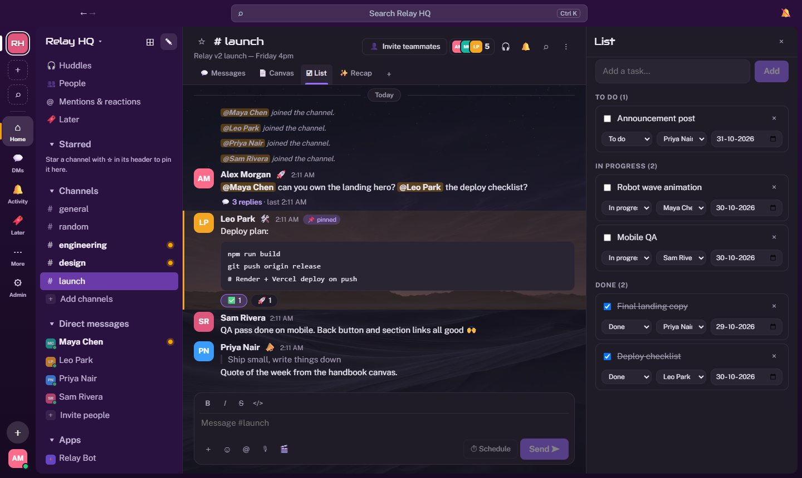
</td>
<td width="50%" valign="top">
<b>🔍 Search</b> <kbd>Ctrl</kbd> + <kbd>K</kbd><br>
<sub>Every message, person and channel at once. End with <code>?</code> for a best answer.</sub>
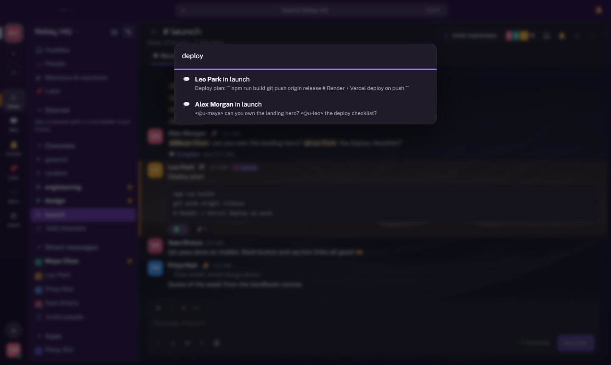
</td>
</tr>
</table>

<details>
<summary><b>🛡️ Admin console</b>: analytics, members, invites, user groups, policies, flagged content, audit log</summary>
<br>
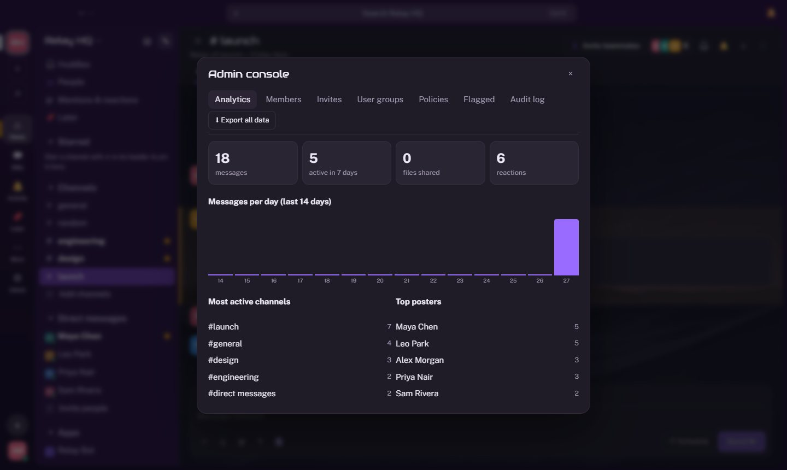
</details>

<details>
<summary><b>📱 On your phone</b></summary>
<br>
<div align="center">

| Home | Workspace |
| :---: | :---: |
| 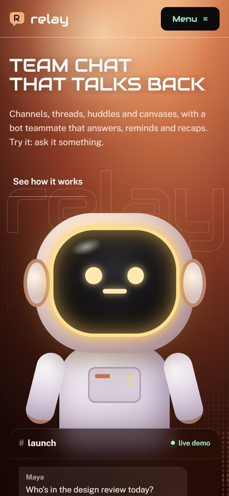 | 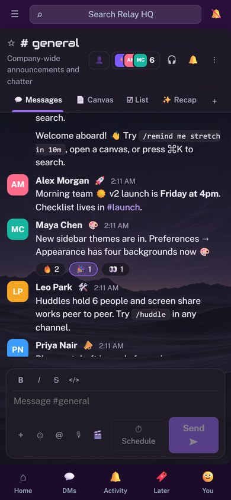 |

</div>
</details>

---

## 🎨 Make it yours

<div align="center">
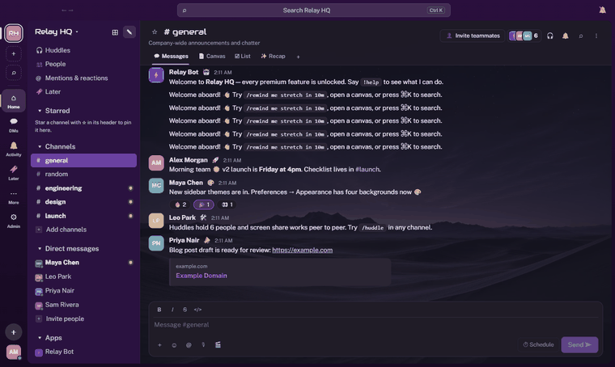
<p><sub>Plum · Moonlight · Meadow · Chrome · Midnight · Overcast. Each moving background comes with a theme matched to it.</sub></p>
</div>

**Preferences → Appearance** picks a workspace background, a colour theme and an accent colour. Each bundled background has a theme matched to it (switch off "Match colours to the background" to mix freely), and a strength slider sets how much of it shows through. You can also upload your own image (kept in your browser, up to 3 MB).

<details>
<summary>Add your own background</summary>

Put a looping 1080p H.264 `.mp4` (no audio) and a `.jpg` poster in `public/bg/`, then add an entry to `BACKGROUNDS` in `src/appearance.ts`.

Moon Walk, Material Hills, Purple Desert and Metal Human backgrounds © GetLayers (getlayers.ai), re-encoded to 1080p for the web.
</details>

---

## ✨ Everything that's unlocked

Channels (public and private), DMs, threads, reactions, edit and delete, pins, saved items, mentions, rich text, file attachments with link previews, presence and typing, unread badges, <kbd>Ctrl</kbd>+<kbd>K</kbd> search, huddles with voice, screen sharing and speaking indicators, canvases, lists, Workflow Builder, scheduled messages, multiple workspaces with invite links, and `/remind` `/topic` `/me` `/shrug` `/huddle` `/summarize` `/recap` `/explain`.

Mapped from the public plan-comparison page (`docs/slack/pricing.md`). Everything runs with no seat limits.

<details open>
<summary><b>Premium feature coverage</b></summary>
<br>

| Area | What Relay has |
| --- | --- |
| 🚀 Productivity | Lists (board by status, assignee, due date), custom sidebar sections, user groups with `@handle` mentions, audio and screen clips, huddle notes posted when a huddle ends |
| 🤖 AI-style | `/recap` daily recap, `/explain <term>`, thread and channel summaries, file summaries for text files, "best answer" when a search ends in `?`. All are local heuristics, not an LLM |
| ⚡ Automation | Workflow Builder with keyword, join and scheduled triggers, conditional branching and starter templates |
| 🛡️ Security and admin | Roles (owner, admin, member, guest), guests see only channels they were added to, admins-only posting, admin console with analytics, audit log, flagged content review |
| 📜 Compliance | Retention policy, legal holds that preserve edited and deleted messages, information barriers between user groups, custom terms of service with re-acceptance, full JSON data export |

Not built because they need external services: Slack Connect, SSO and SCIM, EKM, DLP scanning, data residency, Salesforce/CRM and the app directory.

</details>

<details>
<summary><b>Slash commands cheat sheet</b></summary>
<br>

| Command | What it does |
| --- | --- |
| `/remind me <what> in 10m` | Relay Bot DMs you a reminder (`s`, `m`, `h` or `d`) |
| `/topic <text>` | Sets the channel topic |
| `/huddle` | Starts or joins the channel's huddle |
| `/summarize` | Recaps the channel, or the thread you're in |
| `/recap` | Your daily recap of everything you can see, sent as a DM |
| `/explain <term>` | Finds where your team defined or discussed a term |
| `/me <action>` · `/shrug` | The classics |
| `!help` | Asks Relay Bot what it can do |

</details>

---

## 🧭 How it works

<div align="center">
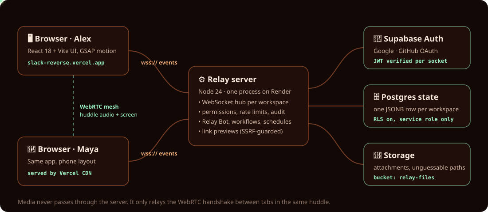
</div>

<details>
<summary><b>Huddles: voice and screen share</b></summary>
<br>

Huddle audio and screen sharing run peer to peer over WebRTC. Every browser in a huddle connects directly to every other one (a mesh), and the Relay server only relays the connection setup (offers, answers, ICE candidates) between tabs in the same huddle. Media never passes through the server. A mesh suits small teams, so a huddle holds up to 6 people (`MAX_HUDDLE` in `src/types.ts`): each person uploads their mic and screen once per other person, so bandwidth and CPU grow with every extra participant.

Browsers find each other with Google's public STUN servers. That works on most home networks, but strict NATs and firewalls (some office, campus and mobile networks) block direct connections, and then the huddle shows people stuck on "connecting". Fix that with a TURN relay (for example coturn, or a hosted one such as Cloudflare Calls, Twilio or Metered) and set these in the UI build:

- `VITE_TURN_URL`: one or more comma-separated URLs, e.g. `turn:turn.example.com:3478,turns:turn.example.com:5349`
- `VITE_TURN_USERNAME` and `VITE_TURN_CREDENTIAL`

They are baked into the UI bundle, so anyone using the app can read them. Use a TURN service with short-lived or usage-capped credentials. For bigger calls (more than about 6 people), the next step is an SFU such as LiveKit, where each browser uploads once and the server forwards the media.

In the console, `await relayHuddle.stats()` shows the bytes and frames sent and received per peer.
</details>

<details>
<summary><b>Security</b></summary>
<br>

- Sign-in is verified on every socket with Supabase. The state table has row-level security on and is only reachable with the server's service key.
- Every event is checked against channel visibility, posting policy, roles and information barriers on the server.
- Attachments are accepted only as inline uploads; link previews refuse private, loopback and link-local addresses, including on redirects and DNS answers.
- Each socket is rate limited, dead sockets are dropped by a heartbeat, and pending writes are flushed when the host restarts the server.
- Without Supabase, identity is a name stored in localStorage, so run that mode only behind a trusted network. With `NODE_ENV=production` the server refuses name-only sign-in unless `RELAY_ALLOW_DEV_AUTH=1` is set.
</details>

---

## 🛠️ Run it locally

```bash
npm install
npm run dev        # API + WebSocket on :8787, UI on :5173
```

<details>
<summary>All scripts</summary>

```bash
npm run build && npm start   # one server on :8787 that also serves the UI
npm run lint                 # tsc --noEmit
npm test                     # node --test
```

Without Supabase settings, state persists to `data/db.json` and sign-in is name-only. The first person to join a workspace becomes its owner.
</details>

## 🚀 Deploy

The live instance runs this setup: the UI at **[slack-reverse.vercel.app](https://slack-reverse.vercel.app)** (Vercel) and the server at **[relay-server-m7b5.onrender.com](https://relay-server-m7b5.onrender.com/healthz)** (Render).

Relay needs a long-running server for WebSockets, so the server runs on a WebSocket-capable host and the UI on Vercel.

1. **Server:** on Render, create a Blueprint from this repo (`render.yaml`). It builds, starts `npm start`, health-checks `/healthz` and runs with `NODE_ENV=production`. Any Node host works: build with `npm run build`, run `npm start`, and set `PORT` (and `DATA_DIR` if you store state on disk).
2. **UI:** in Vercel, import the repo (framework Vite, `vercel.json` is included) and set `VITE_WS_URL=wss://<your-server-host>/ws`. Redeploy after changing it, since it is baked in at build time.
3. **Auth + persistence:** follow [docs/supabase-setup.md](docs/supabase-setup.md) to create the Supabase project, state table and OAuth providers, then set `SUPABASE_URL` / `SUPABASE_SERVICE_ROLE_KEY` on the server and `VITE_SUPABASE_URL` / `VITE_SUPABASE_ANON_KEY` on the UI.

The server also serves the built UI itself, so you can skip Vercel and use the server URL directly.

---

<div align="center">
<sub>Built from publicly known Slack behavior only. No Slack code, assets or private APIs were inspected or copied.<br>
Screenshots: the home and sign-in pages are from the live site; the workspace views are from a local server with demo data.</sub>
</div>
