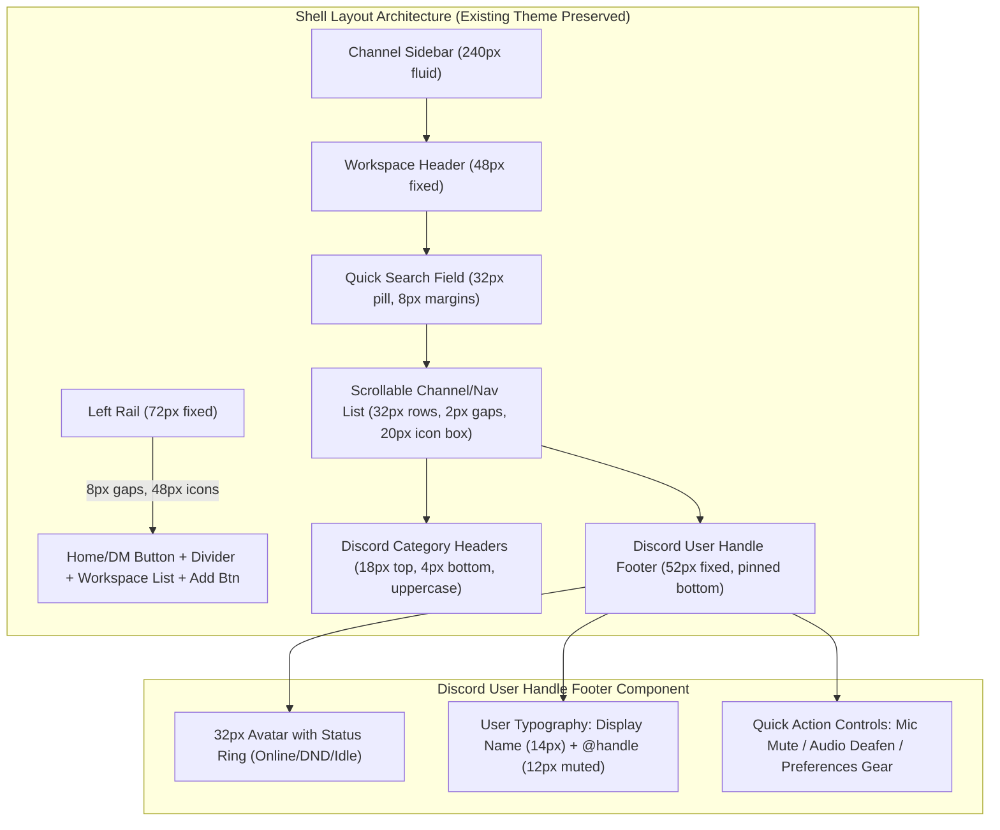

# Discord-Style Layout & Spacing Implementation Plan

> **For agentic workers:** REQUIRED SUB-SKILL: Use superpowers:subagent-driven-development to implement this plan task-by-task. Steps use checkbox (`- [ ]`) syntax for tracking.

**Goal:** Refactor Relay's sidebar and navigation shell to adopt Discord's precise layout, 4px grid spacing, alignment rhythm, and iconic bottom User Handle bar (avatar + status + display name + @handle + mic/deafen/settings controls), without changing the existing color themes or palette.

**Architecture:** Maintain all existing color themes (Apple dark, Apple light, system) while overhauling the CSS layout, flex dimensions, grid spacing, and hierarchy in `src/styles.css` and `src/apple-app.css`. Restructure `src/App.tsx` sidebar footer to replace the 5 stacked utility buttons with the Discord User Handle Footer (`.discord-user-bar`). Align sidebar rows to a uniform 32px height, 20px icon column, and 8px gap. Refactor category headers with Discord's uppercase spacing rhythm (18px above, 4px below) and silence disruptive multi-line empty state hints.

**Architecture Diagram:**



**Tech Stack:** React 19, TypeScript 5.7, Modern CSS (Flexbox / CSS Grid), SVG Icons.

## Global Constraints

- **DO NOT** alter the existing theme palette or color system; retain existing CSS variables (`--bg`, `--panel`, `--text`, `--muted`, `--accent`, `--hover`, `--line`).
- Apply the 4px spacing scale across all containers (margins, paddings, gaps, and row heights).
- Monochromatic line icon boxes: 20px fixed width, 8px gap to labels, perfectly aligned label baselines.
- Retain all existing functionality (channels, DMs, threads, huddles, pages, canvas, lists, preferences).
- Zero new external dependencies.
- TypeScript compilation (`npm run lint`) must pass with 0 errors.

---

### Task 1: Discord-Style User Profile Handle Bar Footer

**Files:**
- Modify: `src/App.tsx:645-660`
- Modify: `src/styles.css:600-660`
- Test: Live webview browser verification of user handle bar, avatar status dot, name/@handle, and quick action buttons.

**Interfaces:**
- Consumes: `me: User`, `connected: boolean`, `dnd`, `setModal`
- Produces: Fixed 52px footer (`.discord-user-bar`) at the bottom of the sidebar with avatar, status, name, handle, mic mute, deafen, and settings buttons.

- [ ] **Step 1: Add mic and deafen state to `src/App.tsx`**

In [src/App.tsx](file:///c:/Users/hashi/Pictures/relay-2/src/App.tsx), add local audio control states for the footer:

```tsx
const [micMuted, setMicMuted] = useState(false);
const [deafened, setDeafened] = useState(false);
```

- [ ] **Step 2: Replace `.side-bottom` with `.discord-user-bar` in `src/App.tsx`**

Replace lines 652-658 of `src/App.tsx`:

```tsx
{/* Discord-style User Handle Footer */}
<div className="discord-user-bar" aria-label="User Account">
  <button className="discord-user-info" onClick={() => setModal('profile')} title="Open profile & preferences">
    <div className="discord-avatar-wrap">
      <Avatar user={me} size={32} online={connected} />
      <span className={`discord-status-dot ${dnd.active ? 'dnd' : connected ? 'online' : 'offline'}`} />
    </div>
    <div className="discord-user-text">
      <span className="discord-display-name">{me?.name || 'User'}</span>
      <span className="discord-handle">@{me?.name?.toLowerCase().replace(/\s+/g, '') || 'you'}</span>
    </div>
  </button>
  <div className="discord-user-controls">
    <button
      className={`discord-ctrl-btn ${micMuted ? 'muted' : ''}`}
      title={micMuted ? 'Unmute microphone' : 'Mute microphone'}
      aria-label="Mute microphone"
      onClick={() => setMicMuted((m) => !m)}
    >
      <Icon n={micMuted ? 'micOff' : 'mic'} size={18} />
    </button>
    <button
      className={`discord-ctrl-btn ${deafened ? 'muted' : ''}`}
      title={deafened ? 'Undeafen audio' : 'Deafen audio'}
      aria-label="Deafen audio"
      onClick={() => setDeafened((d) => !d)}
    >
      <Icon n={deafened ? 'headphonesOff' : 'headphones'} size={18} />
    </button>
    <button
      className="discord-ctrl-btn"
      title="User Settings"
      aria-label="User Settings"
      onClick={() => setModal('profile')}
    >
      <Icon n="settings" size={18} />
    </button>
  </div>
</div>
```

- [ ] **Step 3: Add Discord User Handle Bar layout CSS in `src/styles.css`**

Using the existing theme tokens (`var(--panel)`, `var(--text)`, `var(--muted)`, `var(--hover)`):

```css
/* Discord User Handle Footer */
.discord-user-bar {
  height: 52px;
  min-height: 52px;
  background: color-mix(in srgb, var(--panel) 92%, #000);
  padding: 0 8px;
  display: flex;
  align-items: center;
  justify-content: space-between;
  margin-top: auto;
  border-top: 1px solid var(--hair-c, rgba(255, 255, 255, 0.06));
  z-index: 2;
}

.discord-user-info {
  display: flex;
  align-items: center;
  gap: 8px;
  padding: 4px 6px;
  border-radius: 4px;
  cursor: pointer;
  background: transparent;
  text-align: left;
  flex: 1;
  min-width: 0;
  border: none;
}

.discord-user-info:hover {
  background: var(--hover);
}

.discord-avatar-wrap {
  position: relative;
  width: 32px;
  height: 32px;
  flex-shrink: 0;
}

.discord-status-dot {
  position: absolute;
  bottom: -1px;
  right: -1px;
  width: 10px;
  height: 10px;
  border-radius: 50%;
  border: 2px solid var(--panel);
}

.discord-status-dot.online { background-color: #23a55a; }
.discord-status-dot.dnd { background-color: #f23f43; }
.discord-status-dot.idle { background-color: #f0b232; }
.discord-status-dot.offline { background-color: #80848e; }

.discord-user-text {
  display: flex;
  flex-direction: column;
  min-width: 0;
  line-height: 1.2;
}

.discord-display-name {
  font-size: 14px;
  font-weight: 600;
  color: var(--text);
  white-space: nowrap;
  overflow: hidden;
  text-overflow: ellipsis;
}

.discord-handle {
  font-size: 12px;
  color: var(--muted);
  white-space: nowrap;
  overflow: hidden;
  text-overflow: ellipsis;
}

.discord-user-controls {
  display: flex;
  align-items: center;
  gap: 2px;
}

.discord-ctrl-btn {
  width: 32px;
  height: 32px;
  border-radius: 4px;
  display: flex;
  align-items: center;
  justify-content: center;
  color: var(--muted);
  background: transparent;
  cursor: pointer;
  border: none;
  transition: color 0.15s, background-color 0.15s;
}

.discord-ctrl-btn:hover {
  background: var(--hover);
  color: var(--text);
}

.discord-ctrl-btn.muted {
  color: #f23f43;
}
```

- [ ] **Step 4: Run TypeScript lint to verify types**

Run: `npm run lint`
Expected: PASS with 0 errors.

- [ ] **Step 5: Commit**

```bash
git add src/App.tsx src/styles.css
git commit -m "feat(layout): implement discord user handle bar footer"
```

---

### Task 2: Refactor Sidebar Spacing, Row Density & Alignment to Discord 4px Grid

**Files:**
- Modify: `src/styles.css:350-410`
- Modify: `src/apple-app.css:105-145`
- Modify: `src/apple-shell.css:200-215`

**Interfaces:**
- Consumes: `.side-item`, `.side-section`, `.side-top`, `.side-scroll`
- Produces: Precise Discord row spacing (32px height, 2px gaps, 20px aligned icon column, 8px padding).

- [ ] **Step 1: Standardize `.side-item` dimensions and icon alignment**

In `src/styles.css` and `src/apple-app.css`, unify `.side-item` to match Discord's channel row layout:

```css
/* Discord Channel Row Sizing & Alignment */
.side-item {
  height: 32px;
  min-height: 32px;
  padding: 0 8px;
  margin: 1px 8px;
  border-radius: 4px;
  display: flex;
  align-items: center;
  gap: 8px;
  font-size: 14px;
  font-weight: 500;
  color: var(--muted);
  width: calc(100% - 16px);
  text-align: left;
  border: none;
  transition: background-color 0.12s ease, color 0.12s ease;
}

.side-item:hover {
  background: var(--hover);
  color: var(--text);
}

.side-item.active {
  background: var(--side-active, rgba(255, 255, 255, 0.1)) !important;
  color: var(--text) !important;
  font-weight: 600;
}

/* Icon Box: 20px width, centered, aligned baseline */
.side-item .hash {
  width: 20px;
  height: 20px;
  flex-shrink: 0;
  display: flex;
  align-items: center;
  justify-content: center;
  font-size: 16px;
  color: var(--muted);
  background: transparent !important;
  box-shadow: none !important;
  border-radius: 0 !important;
}

.side-item:hover .hash,
.side-item.active .hash {
  color: var(--text) !important;
}

.side-item .label {
  flex: 1;
  min-width: 0;
  white-space: nowrap;
  overflow: hidden;
  text-overflow: ellipsis;
}
```

- [ ] **Step 2: Refactor Category Header Spacing and Hierarchy**

Update `.side-section` to have Discord's category layout (18px margin above, 4px margin below, uppercase 12px tracked header):

```css
/* Discord Category Section Headers */
.side-section {
  padding: 16px 12px 4px 12px;
  font-size: 12px;
  font-weight: 700;
  text-transform: uppercase;
  letter-spacing: 0.03em;
  color: var(--muted);
  display: flex;
  align-items: center;
  justify-content: space-between;
}

.side-section .side-toggle {
  display: flex;
  align-items: center;
  gap: 4px;
  background: transparent;
  border: none;
  font: inherit;
  color: inherit;
  cursor: pointer;
  padding: 2px 4px;
  border-radius: 4px;
}

.side-section .side-toggle:hover {
  color: var(--text);
}
```

- [ ] **Step 3: Remove vertical layout disruptions in `.side-hint`**

In [src/components/pages/PageTree.tsx](file:///c:/Users/hashi/Pictures/relay-2/src/components/pages/PageTree.tsx#L266) and `src/styles.css`:
Make empty state hints quiet, compact, and non-intrusive (e.g. single-line 11px text or subtle inline tooltip instead of 40px padded paragraphs).

```css
.side-hint {
  padding: 4px 16px 8px;
  font-size: 12px;
  color: var(--muted);
  line-height: 1.3;
  margin: 0;
}
```

- [ ] **Step 4: Run TypeScript lint and appearance unit tests**

Run: `npm run lint && node --test src/appearance.test.ts`
Expected: PASS with 0 errors.

- [ ] **Step 5: Commit**

```bash
git add src/styles.css src/apple-app.css src/apple-shell.css src/components/pages/PageTree.tsx
git commit -m "style(layout): align sidebar items, categories, and spacing to 4px grid"
```

---

### Task 3: Discord-Style Search Bar & Workspace Header

**Files:**
- Modify: `src/App.tsx:564-601`
- Modify: `src/styles.css`

**Interfaces:**
- Consumes: Workspace header and `.side-top` search trigger
- Produces: Compact 48px workspace dropdown header and 32px pill search bar with `<kbd>Ctrl+K</kbd>` keycap.

- [ ] **Step 1: Style the workspace header to Discord's 48px height**

```css
.sidebar header {
  height: 48px;
  min-height: 48px;
  padding: 0 16px;
  display: flex;
  align-items: center;
  justify-content: space-between;
  border-bottom: 1px solid var(--hair-c, rgba(255, 255, 255, 0.06));
}

.sidebar .ws-menu-btn {
  display: flex;
  align-items: center;
  gap: 6px;
  font-size: 15px;
  font-weight: 700;
  color: var(--text);
  border: none;
  background: transparent;
  cursor: pointer;
  padding: 4px 6px;
  border-radius: 4px;
}

.sidebar .ws-menu-btn:hover {
  background: var(--hover);
}
```

- [ ] **Step 2: Restructure the search button to Discord's Quick Switcher pill**

```css
.side-top {
  padding: 8px 8px 4px 8px;
  display: flex;
  flex-direction: column;
  gap: 2px;
}

/* Discord Quick Switcher Search Field */
.side-top .side-item:first-child {
  height: 30px;
  min-height: 30px;
  background: color-mix(in srgb, var(--panel) 70%, #000);
  border-radius: 4px;
  margin: 2px 4px 8px 4px;
  width: calc(100% - 8px);
  padding: 0 8px;
  color: var(--muted);
  display: flex;
  align-items: center;
  justify-content: space-between;
  border: 1px solid var(--hair-c, rgba(255, 255, 255, 0.04));
}

.side-top .side-item:first-child:hover {
  background: var(--hover);
  color: var(--text);
}
```

- [ ] **Step 3: Run TypeScript lint**

Run: `npm run lint`
Expected: PASS

- [ ] **Step 4: Commit**

```bash
git add src/App.tsx src/styles.css
git commit -m "feat(layout): refine workspace header and search pill to discord layout"
```

---

### Task 4: Polish Left Server Rail Layout & Squircle Morph

**Files:**
- Modify: `src/App.tsx:522-562`
- Modify: `src/styles.css`

**Interfaces:**
- Consumes: `<nav className="rail">`
- Produces: 72px fixed rail with 48x48px centered circular icons that morph into squircles (`16px` border-radius) on hover/active, with active pill indicators on the left.

- [ ] **Step 1: Set rail dimensions and item rhythm**

```css
.rail {
  width: 72px;
  min-width: 72px;
  display: flex;
  flex-direction: column;
  align-items: center;
  padding: 12px 0 8px;
  gap: 8px;
  background: color-mix(in srgb, var(--panel) 80%, #000);
}

.rail-btn {
  width: 48px;
  height: 48px;
  border-radius: 50%;
  display: flex;
  align-items: center;
  justify-content: center;
  position: relative;
  transition: border-radius 0.2s cubic-bezier(0.2, 0, 0, 1), background-color 0.2s ease;
  background: var(--panel);
  color: var(--text);
  border: none;
}

.rail-btn:hover,
.rail-btn.active {
  border-radius: 16px;
  background: var(--accent);
  color: #fff;
}
```

- [ ] **Step 2: Add Discord pill indicator bar on the left rail edge**

```css
.rail-btn::before {
  content: '';
  position: absolute;
  left: -12px;
  width: 4px;
  height: 0;
  border-radius: 0 4px 4px 0;
  background: var(--text);
  transition: height 0.15s ease;
}

.rail-btn:hover::before {
  height: 20px;
}

.rail-btn.active::before {
  height: 40px;
}
```

- [ ] **Step 3: Run TypeScript lint**

Run: `npm run lint`
Expected: PASS

- [ ] **Step 4: Commit**

```bash
git add src/App.tsx src/styles.css
git commit -m "style(rail): implement discord rail layout with 48px squircle morph and pill indicator"
```

---

### Task 5: Live Browser Verification and Redline Check

**Files:**
- Verify at: `http://localhost:5174/`

- [ ] **Step 1: Inspect live sidebar layout in browser agent**

Verify:
1. Pinned User Handle Footer at bottom of sidebar (32px avatar + status dot + display name + `@handle` + mic/deafen/settings controls).
2. Clean 4px grid spacing: 32px channel rows, 20px aligned icon column, labels starting at matching baselines.
3. Uppercase category headers with 16px/4px grouping rhythm.
4. Quick switcher search pill in `.side-top`.
5. 72px left rail with 48px icons, squircle hover morph, and active left pill indicator.
6. Existing theme colors are fully preserved.

- [ ] **Step 2: Finalize and commit**

```bash
git commit -am "chore: complete discord layout and spacing refinement"
```
