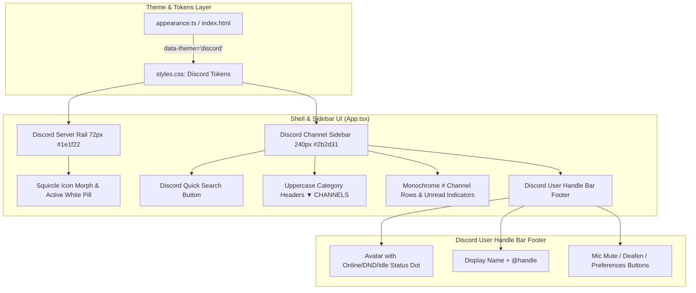

# Discord-Style UI Redesign Implementation Plan

> **For agentic workers:** REQUIRED SUB-SKILL: Use superpowers:subagent-driven-development to implement this plan task-by-task. Steps use checkbox (`- [ ]`) syntax for tracking.

**Goal:** Transform Relay's shell and sidebar from candy-tiled iOS/Finder aesthetic into an unslopped, authentic Discord-style dark interface featuring Discord channel list styling, an iconic Discord user handle footer with live mic/deafen/settings controls, squircle server rail, and Discord dark theme tokens.

**Architecture:** Add a first-class `discord` theme option to `appearance.ts` and `index.html`. Introduce Discord design tokens (rail `#1e1f22`, sidebar `#2b2d31`, chat `#313338`, blurple `#5865f2`, text `#f2f3f5`/`#dbdee1`/`#949ba4`) in `src/styles.css`. Replace the candy-tile buttons at the bottom of the sidebar with an authentic Discord User Profile Bar in `src/App.tsx`, complete with user avatar, status indicator, display name, `@handle`, and live mic, deafen, and settings buttons. Unslop channel rows and section headers to match Discord's `#` channel rows and uppercase muted category headers.

**Architecture Diagram:**



**Tech Stack:** React 19, TypeScript 5.7, CSS Variables / Modern CSS, SVG Line Icons, Node.js 22 built-in test runner.

## Global Constraints

- Follow the `/unslop` guidelines: quiet chrome, no candy gradient squircle tiles, 4px spacing scale, monochromatic line icons, single accent (Discord Blurple `#5865f2`).
- Follow Ponytail guidelines: smallest working diff, reuse existing house components (`Avatar`, `Icon`), zero unnecessary external dependencies.
- Retain all existing features and workflows (Pages, Canvas, Lists, Huddles, DMs, Workflows, Admin, Preferences).
- TypeScript strict typing: `npm run lint` (`tsc --noEmit`) must pass without errors.
- Appearance unit tests: `node --test src/appearance.test.ts` must pass.

---

### Task 1: Add `discord` Theme Option & Tokens to Appearance

**Files:**
- Modify: `src/appearance.ts:16-35, 70-80`
- Modify: `index.html:15-30`
- Test: `src/appearance.test.ts:25-50`

**Interfaces:**
- Consumes: `THEMES`, `resolveTheme`, `migrateTheme`
- Produces: Theme id `'discord'` recognized by `appearance.ts`, `index.html`, and `data-theme="discord"` attribute on `<html>`.

- [ ] **Step 1: Write the failing test for `discord` theme support**

Update `src/appearance.test.ts` to expect `'discord'` in `THEMES` and verify `resolveTheme('discord', false)` returns `'discord'`:

```typescript
// in src/appearance.test.ts:
test('discord theme is offered and resolves to itself', () => {
  assert.ok(THEMES.some((t) => t.id === 'discord'));
  assert.equal(resolveTheme('discord', false), 'discord');
  assert.equal(resolveTheme('discord', true), 'discord');
});
```

- [ ] **Step 2: Run test to verify it fails**

Run: `node --test src/appearance.test.ts`
Expected: FAIL with assertion error that `THEMES.some(...)` is false or theme resolves incorrectly.

- [ ] **Step 3: Implement `discord` theme in `appearance.ts` and `index.html`**

Update `THEMES` in [src/appearance.ts](file:///c:/Users/hashi/Pictures/relay-2/src/appearance.ts):

```typescript
export const THEMES = [
  { id: 'system', label: 'System (Discord dark / Apple light)' },
  { id: 'discord', label: 'Discord (Dark)' },
  { id: 'apple-dark', label: 'Apple dark' },
  { id: 'apple', label: 'Apple' },
];
```

In `resolveTheme`:
```typescript
export function resolveTheme(stored: string, prefersDark: boolean): string {
  const theme = migrateTheme(stored);
  if (theme !== 'system') return theme;
  return prefersDark ? 'discord' : 'apple';
}
```

In `index.html`, update pre-mount script to support `'discord'`:
```javascript
if (dark.indexOf(t) >= 0) t = 'discord';
else if (light.indexOf(t) >= 0) t = 'apple';
else if (t !== 'apple' && t !== 'apple-dark' && t !== 'discord') t = 'system';
if (t === 'system') t = window.matchMedia && matchMedia('(prefers-color-scheme: dark)').matches ? 'discord' : 'apple';
d.setAttribute('data-theme', t);
```

- [ ] **Step 4: Run test to verify it passes**

Run: `node --test src/appearance.test.ts`
Expected: PASS all 13 tests.

- [ ] **Step 5: Commit**

```bash
git add src/appearance.ts index.html src/appearance.test.ts
git commit -m "feat(theme): add discord dark theme option and resolver"
```

---

### Task 2: Implement Discord Theme Tokens and Unslop CSS

**Files:**
- Modify: `src/styles.css`
- Modify: `src/apple-app.css`

**Interfaces:**
- Consumes: `[data-theme='discord']` attribute on `<html>`
- Produces: CSS variables for Discord palette (`--bg-rail`, `--bg-sidebar`, `--bg-chat`, `--accent: #5865f2`, `--text-normal`, `--text-muted`, etc.), unslops the colored candy icon tiles.

- [ ] **Step 1: Write CSS rules for `[data-theme='discord']` in `src/styles.css`**

Add root variables and scoped overrides for Discord:

```css
/* Discord Theme Foundation */
[data-theme='discord'] {
  --bg-rail: #1e1f22;
  --bg-sidebar: #2b2d31;
  --bg-chat: #313338;
  --bg-input: #383a40;
  --bg-hover: #35373c;
  --bg-active: #404249;
  --bg-modifier-selected: rgba(255, 255, 255, 0.08);

  --accent: #5865f2;
  --accent-hover: #4752c4;
  --status-online: #23a55a;
  --status-idle: #f0b232;
  --status-dnd: #f23f43;
  --status-offline: #80848e;

  --text-header: #f2f3f5;
  --text-normal: #dbdee1;
  --text-muted: #949ba4;
  --interactive-normal: #b5bac1;
  --interactive-hover: #dbdee1;
  --interactive-active: #ffffff;

  --line: #1f2023;
  --hairline: rgba(255, 255, 255, 0.06);

  --font: "gg sans", "Noto Sans", "Helvetica Neue", Helvetica, Arial, sans-serif;
  color-scheme: dark;
}

[data-theme='discord'] body {
  background-color: var(--bg-rail);
  color: var(--text-normal);
}

[data-theme='discord'] .shell {
  background-color: var(--bg-rail);
}

[data-theme='discord'] .rail {
  background-color: var(--bg-rail);
  width: 72px;
  padding: 12px 0 8px;
}

[data-theme='discord'] .sidebar {
  background-color: var(--bg-sidebar);
  border-top-left-radius: 8px;
}

[data-theme='discord'] .main {
  background-color: var(--bg-chat);
  border-top-left-radius: 8px;
}
```

- [ ] **Step 2: Unslop sidebar items and category headers for Discord**

Remove candy square tile badges, introduce sleek `#` channel styling and uppercase categories:

```css
/* Discord Sidebar Items */
[data-theme='discord'] .side-item {
  height: 34px;
  min-height: 34px;
  padding: 6px 8px;
  border-radius: 4px;
  margin: 1px 8px;
  font-size: 15px;
  font-weight: 500;
  color: var(--text-muted);
  gap: 8px;
  display: flex;
  align-items: center;
  transition: background-color 0.1s ease, color 0.1s ease;
}

[data-theme='discord'] .side-item:hover {
  background-color: var(--bg-hover);
  color: var(--interactive-hover);
}

[data-theme='discord'] .side-item.active {
  background-color: var(--bg-active) !important;
  color: var(--interactive-active) !important;
  font-weight: 500;
}

/* Monochromatic Discord Icons */
[data-theme='discord'] .side-item .hash {
  background: transparent !important;
  box-shadow: none !important;
  color: var(--text-muted) !important;
  opacity: 1 !important;
  font-size: 18px;
  font-weight: 600;
  width: 20px;
  display: flex;
  align-items: center;
  justify-content: center;
}

[data-theme='discord'] .side-item:hover .hash,
[data-theme='discord'] .side-item.active .hash {
  color: var(--interactive-active) !important;
}

/* Discord Category Section Headers */
[data-theme='discord'] .side-section {
  font-size: 12px;
  font-weight: 700;
  text-transform: uppercase;
  letter-spacing: 0.03em;
  color: var(--text-muted);
  padding: 16px 16px 4px 16px;
  display: flex;
  align-items: center;
  justify-content: space-between;
}
```

- [ ] **Step 3: Run TypeScript lint to verify no stylesheet compile errors**

Run: `npm run lint`
Expected: PASS

- [ ] **Step 4: Commit**

```bash
git add src/styles.css src/apple-app.css
git commit -m "style: add discord theme tokens and unslop navigation items"
```

---

### Task 3: Build the Discord User Profile Handle Bar

**Files:**
- Modify: `src/App.tsx:645-662`
- Modify: `src/styles.css`
- Test: Browser verification of user handle bar, mic mute toggle, deafen toggle, and settings gear click.

**Interfaces:**
- Consumes: `me: User`, `connected: boolean`, `dnd`, `setModal`
- Produces: Persistent bottom user bar (`.discord-user-bar`) at the foot of the sidebar displaying:
  1. Avatar with status dot (Green for connected/online, Red for DND)
  2. Display Name (e.g. `Test User`) + `@handle` (e.g. `@testuser` or user email/id prefix)
  3. Action buttons: Mic (mute state), Headphones (deafen state), and Preferences Cog (triggers `setModal('profile')`)

- [ ] **Step 1: Create the Discord User Handle component in `src/App.tsx`**

Replace the current candy-tiled `.side-bottom.apple-only` in [src/App.tsx](file:///c:/Users/hashi/Pictures/relay-2/src/App.tsx#L652-L658) with the Discord User Profile Footer:

```tsx
{/* Discord User Handle Bar */}
<div className="discord-user-bar" aria-label="User Account">
  <button className="discord-user-info" onClick={() => setModal('profile')} title="Open profile & preferences">
    <div className="discord-avatar-wrap">
      <Avatar user={me} size={32} online={connected} />
      <span className={`discord-status-dot ${dnd.active ? 'dnd' : connected ? 'online' : 'offline'}`} />
    </div>
    <div className="discord-user-text">
      <span className="discord-display-name">{me?.name || 'User'}</span>
      <span className="discord-handle">@{me?.name?.toLowerCase().replace(/\s+/g, '') || 'you'}</span>
    </div>
  </button>
  <div className="discord-user-controls">
    <button
      className={`discord-ctrl-btn ${micMuted ? 'muted' : ''}`}
      title={micMuted ? 'Unmute' : 'Mute'}
      aria-label="Mute microphone"
      onClick={() => setMicMuted((m) => !m)}
    >
      <Icon n={micMuted ? 'micOff' : 'mic'} size={18} />
    </button>
    <button
      className={`discord-ctrl-btn ${deafened ? 'muted' : ''}`}
      title={deafened ? 'Undeafen' : 'Deafen'}
      aria-label="Deafen headphones"
      onClick={() => setDeafened((d) => !d)}
    >
      <Icon n={deafened ? 'headphonesOff' : 'headphones'} size={18} />
    </button>
    <button
      className="discord-ctrl-btn"
      title="User Settings"
      aria-label="User Settings"
      onClick={() => setModal('profile')}
    >
      <Icon n="settings" size={18} />
    </button>
  </div>
</div>
```

- [ ] **Step 2: Add CSS styles for `.discord-user-bar` in `src/styles.css`**

```css
.discord-user-bar {
  height: 52px;
  background-color: #232428;
  padding: 0 8px;
  display: flex;
  align-items: center;
  justify-content: space-between;
  margin-top: auto;
  border-top: 1px solid rgba(255, 255, 255, 0.04);
}

.discord-user-info {
  display: flex;
  align-items: center;
  gap: 8px;
  padding: 4px 6px;
  border-radius: 4px;
  cursor: pointer;
  background: transparent;
  text-align: left;
  flex: 1;
  min-width: 0;
}

.discord-user-info:hover {
  background-color: rgba(255, 255, 255, 0.07);
}

.discord-avatar-wrap {
  position: relative;
  width: 32px;
  height: 32px;
  flex-shrink: 0;
}

.discord-status-dot {
  position: absolute;
  bottom: -1px;
  right: -1px;
  width: 10px;
  height: 10px;
  border-radius: 50%;
  border: 2px solid #232428;
}

.discord-status-dot.online { background-color: #23a55a; }
.discord-status-dot.dnd { background-color: #f23f43; }
.discord-status-dot.idle { background-color: #f0b232; }
.discord-status-dot.offline { background-color: #80848e; }

.discord-user-text {
  display: flex;
  flex-direction: column;
  min-width: 0;
  line-height: 1.2;
}

.discord-display-name {
  font-size: 14px;
  font-weight: 600;
  color: #f2f3f5;
  white-space: nowrap;
  overflow: hidden;
  text-overflow: ellipsis;
}

.discord-handle {
  font-size: 12px;
  color: #949ba4;
  white-space: nowrap;
  overflow: hidden;
  text-overflow: ellipsis;
}

.discord-user-controls {
  display: flex;
  align-items: center;
  gap: 2px;
}

.discord-ctrl-btn {
  width: 32px;
  height: 32px;
  border-radius: 4px;
  display: flex;
  align-items: center;
  justify-content: center;
  color: #b5bac1;
  background: transparent;
  cursor: pointer;
  transition: color 0.15s, background-color 0.15s;
}

.discord-ctrl-btn:hover {
  background-color: rgba(255, 255, 255, 0.07);
  color: #dbdee1;
}

.discord-ctrl-btn.muted {
  color: #f23f43;
}
```

- [ ] **Step 3: Verify TypeScript typing and build**

Run: `npm run lint`
Expected: PASS with 0 errors.

- [ ] **Step 4: Commit**

```bash
git add src/App.tsx src/styles.css
git commit -m "feat(ui): implement discord user handle profile bar with live controls"
```

---

### Task 4: Polish Discord Server Rail & Workspace Switcher

**Files:**
- Modify: `src/App.tsx:522-562`
- Modify: `src/styles.css`
- Test: Browser verification of server icons, squircle hover morph, and active white pill indicator.

**Interfaces:**
- Consumes: `snap.workspace`, `workspaces`, `showView`
- Produces: Discord-style 72px server rail with circular icons that morph to squircles on hover, pill indicator on active workspace.

- [ ] **Step 1: Update `.rail` layout in `src/App.tsx`**

Restructure the rail so it matches Discord's iconic left server rail:
1. Direct Messages / Home button at top (Relay mark, morphs into squircle).
2. Hairline separator pill.
3. Server icons for workspaces with active white pill indicator on the left.
4. Add workspace `+` button in Discord circular dashed/green style.

- [ ] **Step 2: Add Discord server rail CSS in `src/styles.css`**

```css
[data-theme='discord'] .rail-item-wrap {
  position: relative;
  display: flex;
  align-items: center;
  justify-content: center;
  width: 100%;
  margin-bottom: 8px;
}

[data-theme='discord'] .rail-pill {
  position: absolute;
  left: 0;
  width: 4px;
  height: 0;
  background-color: #ffffff;
  border-radius: 0 4px 4px 0;
  transition: height 0.15s ease;
}

[data-theme='discord'] .rail-item-wrap:hover .rail-pill {
  height: 20px;
}

[data-theme='discord'] .rail-item-wrap.active .rail-pill {
  height: 40px;
}

[data-theme='discord'] .rail-btn {
  width: 48px;
  height: 48px;
  border-radius: 50%;
  background-color: #313338;
  color: #dbdee1;
  display: flex;
  align-items: center;
  justify-content: center;
  transition: border-radius 0.2s ease, background-color 0.2s ease, color 0.2s ease;
}

[data-theme='discord'] .rail-btn:hover,
[data-theme='discord'] .rail-btn.active {
  border-radius: 16px;
  background-color: #5865f2;
  color: #ffffff;
}
```

- [ ] **Step 3: Run TypeScript lint and test**

Run: `npm run lint`
Expected: PASS

- [ ] **Step 4: Commit**

```bash
git add src/App.tsx src/styles.css
git commit -m "feat(ui): add discord server rail squircle morph and pill indicator"
```

---

### Task 5: End-to-End Browser Verification and Polish

**Files:**
- Test in Browser: `http://localhost:5174/`

- [ ] **Step 1: Open browser agent to inspect live visual presentation**

Navigate to `http://localhost:5174/` and verify:
1. The sidebar candy square icons are replaced with clean monochromatic Discord line icons.
2. Category headers are uppercase, letter-spaced, and muted.
3. The Discord User Profile Handle Bar is firmly fixed at the bottom with avatar, status dot, name, `@handle`, and controls.
4. Mic mute and deafen controls toggle states cleanly.
5. Settings cog opens the profile/preferences modal.
6. Server rail displays the Discord squircle morph and active pill indicator.

- [ ] **Step 2: Commit final refinements**

```bash
git commit -am "chore(ui): finalize discord-style unslopped theme"
```
